  

### What FinalPing does

- **Pings you as your aircraft comes home:** at 10, 5 and 2 nm out, on landing and on takeoff, every lap of the pattern.
- **Wherever you already are:** Discord, Slack, Microsoft Teams, Google Chat, email, text, Telegram or your own webhook.
- **A live map worth watching:** 3D models of each aircraft type, its whole flight path, terrain, and a follow camera.
- **Your own receiver if you want it:** a Raspberry Pi ground station at your field for wheels-down timing, set up with one command.

  
  

### Built with

  
  
  
  
  
  
  
  
  
  
  
  

### Where it lives

| | |
|---|---|
| [**my-product-site**](https://github.com/ShermR6/my-product-site) | finalpingapp.com and the web app: dashboard, live map, alerts |
| [**aircraft-tracker-backend**](https://github.com/ShermR6/aircraft-tracker-backend) | The tracking and alert engine, plus the Raspberry Pi receiver |

<picture>
  <source media="(prefers-color-scheme: dark)" srcset="https://raw.githubusercontent.com/ShermR6/ShermR6/output/snake-dark.svg">
  <source media="(prefers-color-scheme: light)" srcset="https://raw.githubusercontent.com/ShermR6/ShermR6/output/snake.svg">
  
</picture>
