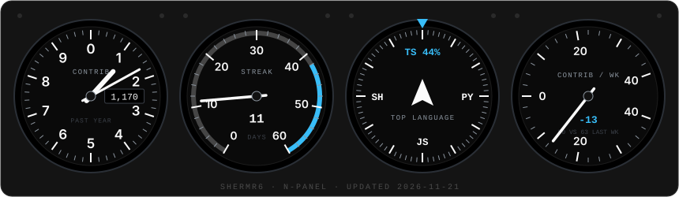

  

  

  
  

### Instruments

### Built with

  
  
  
  
  
  
  
  
  
  
  
  

### On the scope

| Repo | What it is |
|---|---|
| [**my-product-site**](https://github.com/ShermR6/my-product-site) | finalpingapp.com and the web app: dashboard, live map, alerts |
| [**aircraft-tracker-backend**](https://github.com/ShermR6/aircraft-tracker-backend) | The tracking and alert engine, plus the Raspberry Pi receiver |

### Flight log

